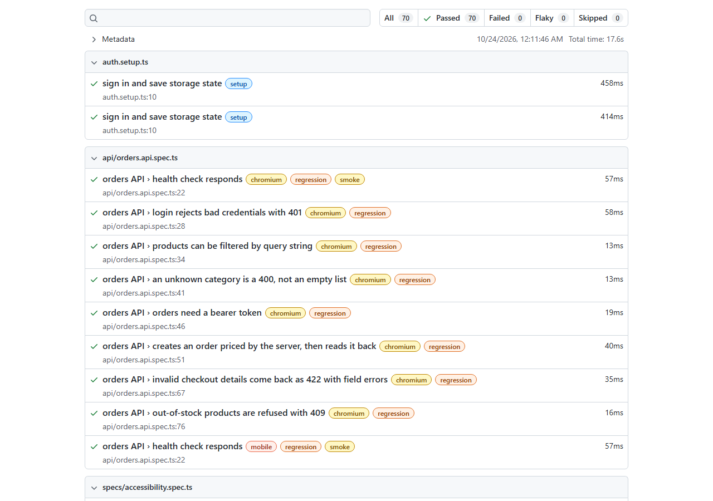

# e2e-testing-lab

This repository is a worked example of end-to-end testing done carefully. It contains a small online store for clinic supplies (log in, browse gloves and masks, fill a cart, check out) and a Playwright test suite that exercises it the way a professional QA or frontend team would: page objects, shared fixtures, deliberately broken networks, screenshot comparison, accessibility scans and a CI pipeline that splits the suite across machines.

The store is only there to be tested. The tests are what this repository is meant to show.

- **Live app:** https://e2e-testing-lab-opal.vercel.app (demo login is printed on the sign-in page: `nurse@clinic.test` / `supplies123`)
- **CI:** every push runs lint, type checks, unit tests, an `npm audit`, and the Playwright suite in two shards. The shards' results are merged into one HTML report, which is uploaded as the `playwright-report` artifact.



## Testing techniques shown

| Technique | Where to look | What it demonstrates |
| --- | --- | --- |
| Page object models | [`e2e/pages/`](e2e/pages) | One class per screen. Locators are role-based (`getByRole`, `getByLabel`); the app has no `data-testid` attributes at all |
| Custom fixtures with `test.extend` | [`e2e/fixtures.ts`](e2e/fixtures.ts) | Overrides the built-in `storageState` option so each test starts signed in; exposes page objects, a `cartWith([...])` helper and an axe builder as fixtures |
| Login once, reuse the session | [`e2e/auth.setup.ts`](e2e/auth.setup.ts) | A `setup` project signs in through the real form and saves `storageState`; browser projects depend on it |
| Data-driven tests | [`e2e/data/`](e2e/data), [`catalog.spec.ts`](e2e/specs/catalog.spec.ts), [`checkout.spec.ts`](e2e/specs/checkout.spec.ts) | Search/filter cases and checkout validation cases live in small tables; each row becomes a named test |
| Network mocking and failure injection | [`network.spec.ts`](e2e/specs/network.spec.ts) | `page.route` returns a 500 once and the retry button recovers; aborted connections; a gated slow response; a 503 during checkout; rewriting a real response with `route.fetch` |
| Timing problems solved without sleeps | [`search-race.spec.ts`](e2e/specs/search-race.spec.ts) | See "A flaky-looking test, fixed properly" below |
| Visual regression | [`visual.spec.ts`](e2e/specs/visual.spec.ts) | `toHaveScreenshot` on three components (login card, product card, order summary), Linux baselines only |
| Accessibility | [`accessibility.spec.ts`](e2e/specs/accessibility.spec.ts) | axe-core scans against WCAG 2.1 A/AA, including error states (failed API, invalid checkout) |
| API testing | [`orders.api.spec.ts`](e2e/api/orders.api.spec.ts) | The `request` fixture hits the HTTP API directly: auth, 400/401/409/422 responses, server-side pricing |
| Tags and `--grep` | every spec | Tests are tagged `@smoke`, `@regression` or `@visual`. The `mobile` project (Pixel 7) runs only `@smoke` through a project-level `grep` |
| Retries and traces | [`playwright.config.ts`](playwright.config.ts) | Two retries on CI, `trace: "on-first-retry"`, screenshots on failure |
| Sharding and merged reports | [`.github/workflows/ci.yml`](.github/workflows/ci.yml) | Two shard jobs write blob reports; a final job runs `merge-reports` and uploads one HTML report |
| Lint rules against flaky habits | [`eslint.config.js`](eslint.config.js) | `eslint-plugin-playwright` blocks `waitForTimeout`, `networkidle` and non-retrying assertions |
| Unit tests for the logic | [`src/domain/*.test.ts`](src/domain), [`src/mocks/api.test.ts`](src/mocks/api.test.ts) | Vitest covers cart totals, shipping and tax, Luhn and expiry checks, and the mock API's routes |

## A flaky-looking test, fixed properly

The search box waits 300 ms after you stop typing, then calls the API, and the API takes a variable amount of time to answer (150 to 500 ms on the live site). A test written like this passes on a fast laptop and fails now and then on CI:

```ts
await productsPage.searchFor("n95");
await page.waitForTimeout(1000);
expect(await productsPage.cards.count()).toBe(1);
```

It is not really flaky. It is guessing at timing. Adding a longer sleep only makes the guess fail less often, and the suite gets slower. The fixes in [`search-race.spec.ts`](e2e/specs/search-race.spec.ts) don't guess:

1. **Assert on the outcome, not at a moment.** `await expect(cards.getByRole("heading")).toHaveText(["N95 respirators"])` re-checks the page until it matches or times out. It is as fast as the app and as patient as it needs to be.
2. **Make the rare case happen every time.** There was a second, nastier race underneath: if you type "nitrile", then "n95", and the "nitrile" response arrives last, it can overwrite the newer results. In real use that happens once in a while. The test uses `page.route` to hold the "nitrile" response until the "n95" results are showing, then releases it, and checks the list still shows N95. The app passes because it cancels superseded requests with an `AbortController`. To check that the test really guards this, I deleted the cancellation, and the test failed with the gloves showing up in place of the N95 results.

## Bugs the suite found

The suite caught one real bug while I was building the app:

- **Placing an order sometimes landed on an empty cart instead of the confirmation.** The checkout page sends you back to the cart when the cart is empty. After a successful order the code cleared the cart and then navigated to the confirmation. React Router runs navigation as a transition, so the cart clearing rendered first, the empty-cart redirect won, and the shopper was dropped on `/cart`. Every checkout test that placed an order failed on its first run. The fix records that the order was placed, so the guard doesn't fire ([`CheckoutPage.tsx`](src/pages/CheckoutPage.tsx)).

The axe scans found no violations, and I haven't invented any to make the report look busier.

## How the mock API works, and why the tests do not use the service worker

There is no backend. All the API logic is in [`src/mocks/api.ts`](src/mocks/api.ts) and is written against the standard `Request` and `Response` types, so it runs in two places:

- **On the deployed site**, [Mock Service Worker](https://mswjs.io) answers `/api/*` in the browser, which keeps the site fully static on Vercel.
- **Under Playwright**, the app is built with `VITE_API_MODE=network` and calls the same code over real HTTP, served by a small Vite middleware ([`vite.config.ts`](vite.config.ts)).

The split exists because `page.route` cannot see requests that a service worker answers, a documented Playwright limitation. Serving the API over HTTP lets every test intercept, delay or break any call, and lets the API tests use the `request` fixture. Service workers are blocked in local runs (`serviceWorkers: "block"`) so nothing can quietly answer instead.

## Running it

Requires Node 22.

```bash
npm ci
npx playwright install chromium

npm test                     # Vitest unit tests
npm run test:e2e             # whole Playwright suite (builds and serves the app on port 47240)
npm run test:smoke           # only @smoke
npm run test:regression      # only @regression
npx playwright show-report   # open the last HTML report
```

**Against the live site.** Set `BASE_URL` and no local server is started:

```bash
BASE_URL=https://e2e-testing-lab-opal.vercel.app npx playwright test --grep @smoke
```

I ran this once against the deployment: 9 passed on desktop and mobile Chrome, and 2 were skipped. The skipped ones are the API test (the static site has no HTTP API, only the in-browser worker) and its mobile copy.

**Sharding locally.** This is the same split CI uses:

```bash
npx playwright test --shard=1/2
npx playwright test --shard=2/2
```

On CI each shard writes a blob report, and `npx playwright merge-reports --reporter html ./all-blob-reports` combines them.

**Visual baselines.** Fonts render differently on Windows, macOS and Linux, so only `*-chromium-linux.png` baselines are committed. They are generated in the same `mcr.microsoft.com/playwright:v1.55.1-noble` image that CI uses. On other operating systems `playwright.config.ts` skips `@visual` tests (set `FORCE_VISUAL=1` to run them anyway against your own local baselines, which git ignores). To update the baselines after an intentional UI change:

1. Run the **Update visual baselines** workflow from the Actions tab (it runs `--grep @visual --update-snapshots` in the container).
2. Download its `visual-baselines` artifact into `e2e/specs/visual.spec.ts-snapshots/` and commit it.

With Docker, the same should work locally. I used the workflow, so this command is untested:

```bash
docker run --rm -v "$PWD":/work -v /work/node_modules -w /work \
  mcr.microsoft.com/playwright:v1.55.1-noble \
  sh -c "npm ci && npx playwright test --grep @visual --update-snapshots --project=chromium"
```

## Layout

```
src/domain/      cart totals, checkout validation, catalog (pure functions, unit tested)
src/mocks/       the mock API, plus the MSW worker that serves it in the browser
src/pages/       login, products, cart, checkout, confirmation
e2e/pages/       page objects
e2e/data/        test data tables
e2e/specs/       browser tests
e2e/api/         request-fixture API tests
```

## Limits

- The browser tests run in Chromium only, desktop plus a Pixel 7 profile for `@smoke`. Adding Firefox and WebKit is a config change, but it would need its own visual baselines.
- Tests run against the "network" build, not the exact MSW build that is deployed. The `BASE_URL` smoke run is what covers the deployed build.
- Orders live in memory. On the live site they vanish when the tab closes, and in local runs when the preview server stops.
- Payment is pretend. The card field only runs a Luhn check, and the test card is `4242 4242 4242 4242`.

## License

[MIT](LICENSE)
